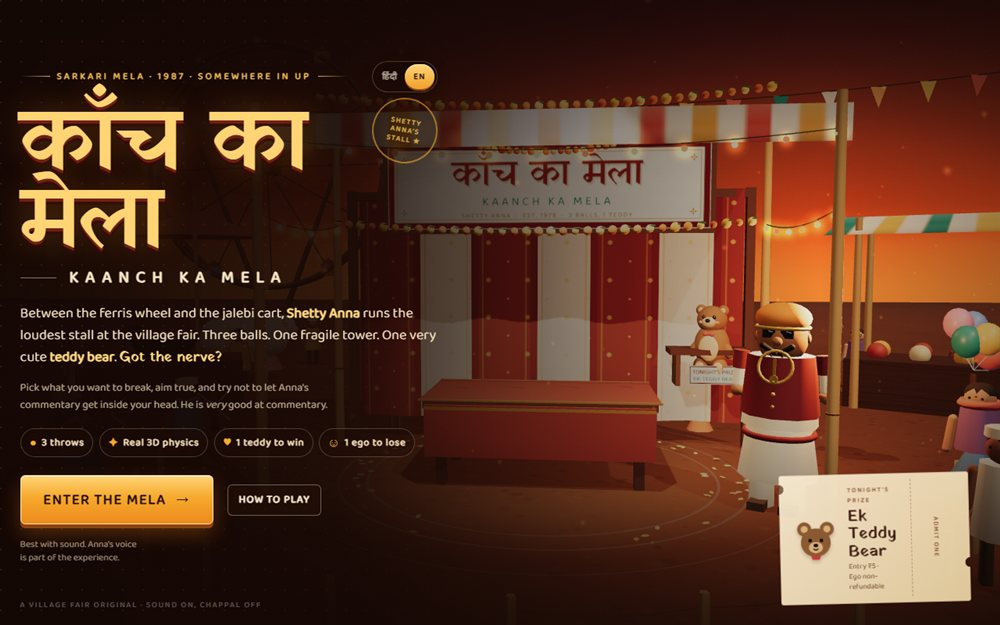

# Kaanch Ka Mela

Three balls, one fragile tower, one teddy: a fairground physics game set in a 1987 sarkari mela.

**[Open the live site](https://ajeet-iitk.github.io/kaancha-mela/)**



## What it does

A stall at the village fair. Three glass balls, a wobbling stack of prizes, and a teddy at the top. Aim, throw, and try not to shatter everything on the way to the prize while the stall owner comments on your technique.

## Features

- Real-time 3D scene with first-person throwing physics
- One teddy to win, one ego to lose - three throws per attempt
- Hindi and English interface
- Sound design for the stall, the crowd and the glass

## Build and run

The source lives in `src/` and is bundled by `build.mjs`:

```bash
npm install
node build.mjs
```

Then open `index.html`, or play the hosted build:

<https://ajeet-iitk.github.io/kaancha-mela/>

## Files

| Path | Purpose |
| --- | --- |
| `index.html` | Landing page |
| `kaancha-mela.html` | Built game bundle |
| `src/` | Game source |
| `build.mjs` | Build script |
| `tools/` | Helper scripts |

---

Part of [my collection of small projects](https://github.com/Ajeet-iitk).
